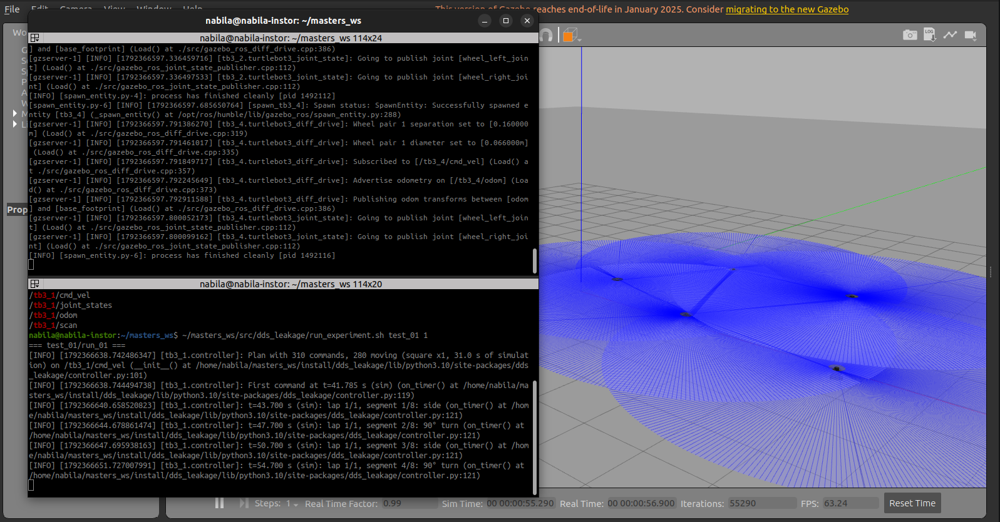
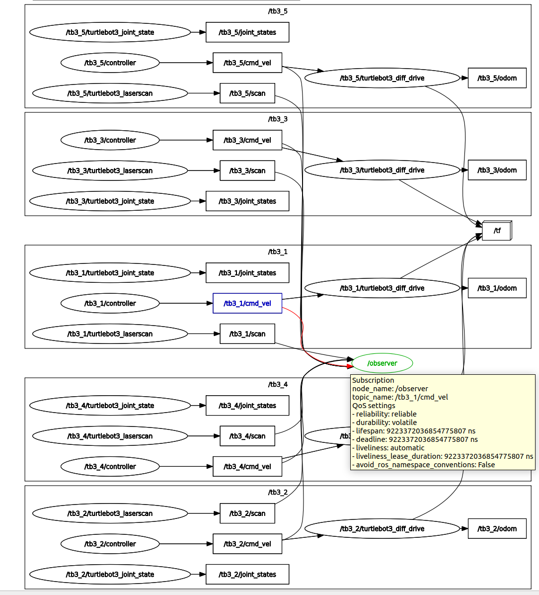
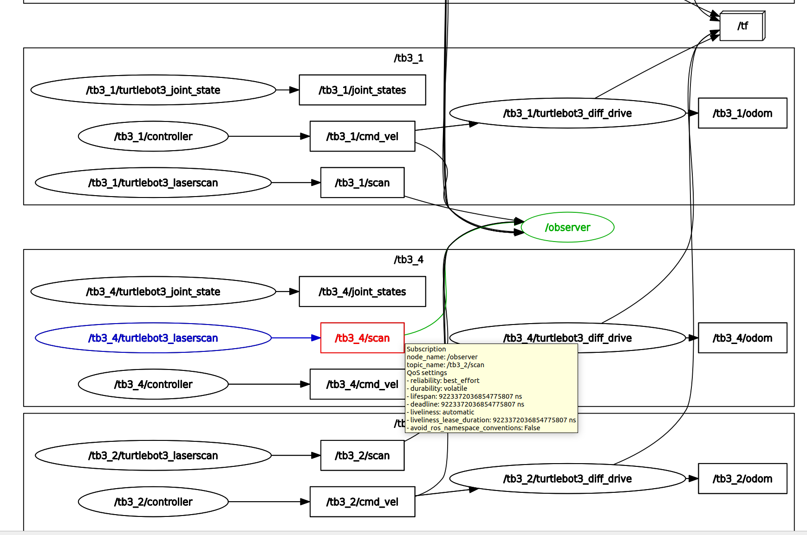

# dds_leakage

A ROS 2 package that measures **how much of a robot's trajectory can be inferred just by
listening to DDS traffic**.

In a ROS 2 system, any participant on the same network and DDS domain automatically discovers
the other participants' topics and can subscribe to them. Here, several simulated TurtleBot3
robots in Gazebo drive different geometric shapes, commanded through `cmd_vel`. A passive
**observer**, with no configuration about the robots, discovers the `*/cmd_vel` and `*/scan`
topics and records every message. At the same time, the **true pose** of each robot is recorded
from Gazebo as ground truth. The datasets make it possible to evaluate afterwards whether the
trajectory (and the shape driven) can be reconstructed from the observed traffic alone.

## Layout

The commands below assume the workspace is at `~/dds_leakage_ws`, with the package in `src/`:

```
dds_leakage_ws/
└── src/
    └── dds_leakage/
        ├── dds_leakage/
        │   ├── controller.py             # publishes the velocity sequence of a shape on cmd_vel
        │   ├── observer.py               # discovers and records every */cmd_vel and */scan topic
        │   └── ground_truth_recorder.py  # records the true pose of each robot
        ├── sim/
        │   ├── sim_multi.launch.py       # Gazebo + 5 TurtleBot3 Burger (/tb3_1 .. /tb3_5)
        │   ├── empty_with_state.world    # empty world that publishes /gazebo/model_states
        │   └── gazebo_params.yaml        # /clock published at 200 Hz
        ├── analysis/
        │   └── quick_check.py            # CSV summary and x-y plot for one robot in one run
        ├── test/                         # flake8 and pep257 linters (colcon test)
        ├── data/                         # experiment output: data/<condition>/run_NN/<robot>/
        ├── env.sh                        # project environment (ROS, Gazebo, DDS domain)
        └── run_experiment.sh             # runs N repetitions of the experiment
```

## Components

### Simulation (`sim/sim_multi.launch.py`)

Starts Gazebo with an empty world and spawns 5 TurtleBot3 Burger robots, each in its own
namespace (`/tb3_1` .. `/tb3_5`). Each robot publishes `odom`, `scan` and `joint_states` and
subscribes to `cmd_vel`. The robot model is a copy of the standard one **without the IMU**,
generated at launch time: the IMU link has no mass or geometry, so removing it does not change
the dynamics.

The world publishes `/gazebo/model_states` (the true pose of every model) at 50 Hz, and
`/clock` is published at 200 Hz.

### Controller 

Publishes on `cmd_vel` (relative to its namespace) a **deterministic** plan of `Twist` commands
at **10 Hz in simulation time**. The plan is built before it starts:

1. `start_delay` (2 s) of zero commands;
2. the segments of the chosen shape, repeated `laps` times;
3. `stop_time` (1 s) of zero commands.

Each segment is a straight line (`v` only), an in-place turn (`w` only) or an arc (`v` and `w`
together). Each segment's duration is rounded to a whole number of commands, and `v`/`w` are
recomputed so the geometry stays exact. All shapes turn left and end at the starting point.

| `path`     | Shape                                   | Duration per lap |
| ------------ | --------------------------------------- | ---------------- |
| `square`   | 4 sides of 0.60 m + 90° turns          | ~28 s            |
| `triangle` | 3 sides of 0.80 m + 120° turns         | ~28 s            |
| `circle`   | 0.50 m radius, constant `v` and `w` | ~21 s            |
| `up_down`  | 1.50 m out, 180° turn, 1.50 m back     | ~26 s            |
| `hexagon`  | 6 sides of 0.60 m + 60° turns          | ~36 s            |

Parameters: `path` (required), `laps` (default `1`), `start_delay` (default `2.0` s),
`stop_time` (default `1.0` s). On startup, the log reports the total number of planned commands
and how many of them are moving commands; `run_experiment.sh` uses this to check what was
observed.

### Observer

A regular DDS participant. Every `discovery_period` (0.2 s) it queries the ROS graph and
subscribes to every known topic that shows up with the expected type. The topics are listed in
the `STREAMS` table in `observer.py`:

| Topic         | Type                          | File                  | QoS         | Rate  |
| ------------- | ----------------------------- | --------------------- | ----------- | ----- |
| `*/cmd_vel` | `geometry_msgs/msg/Twist`   | `observed_data.csv` | reliable    | 10 Hz |
| `*/scan`    | `sensor_msgs/msg/LaserScan` | `observed_scan.csv` | best effort | 5 Hz  |

The scan subscription must be best effort because Gazebo's laser plugin publishes that way, and a
reliable subscriber would receive nothing. The TurtleBot3 lidar has 360 beams (one per degree,
starting at 0 rad, counterclockwise), range 0.12–3.5 m; readings with no hit are `inf`. Since
the world is empty, the only things the lidar can hit are the other robots within 3.5 m.

It also logs who publishes and who subscribes to each topic, information that DDS discovery
itself provides. Each topic becomes one file in the robot's folder:
`/tb3_1/cmd_vel` → `<output_dir>/tb3_1/observed_data.csv`. The parameter `output_dir` is
required.

### Ground truth recorder

Subscribes to `/gazebo/model_states` and records the pose (x, y, yaw) of the models listed in
`model_names` to `<output_dir>/<model>/ground_truth.csv`, at ~50 Hz. The parameter `output_dir`
is required.

All three nodes use `use_sim_time`, so every timestamp in the CSVs is on the simulation clock.
Since `Twist` and `ModelStates` carry no timestamp, the recorded time is the **reception time**.
The recorders open their files in exclusive mode and fail if the file already exists, so a run
is never overwritten.

## Installation

Create the ROS 2 workspace directory and its `src/` folder with:

```bash
mkdir -p ~/dds_leakage_ws/src
```

Place this package inside `~/dds_leakage_ws/src/dds_leakage/` before following the
requirements and build steps below.

## Requirements

- Ubuntu 22.04 with **ROS 2 Humble**
- **Gazebo Classic 11** with `gazebo_ros_pkgs`
- TurtleBot3 simulation packages (`turtlebot3_gazebo`)
- Python 3 with `pandas` and `matplotlib` (analysis only)

```bash
sudo apt install ros-humble-desktop ros-humble-gazebo-ros-pkgs \
    ros-humble-turtlebot3-gazebo python3-pandas python3-matplotlib
```

## Environment

`env.sh` loads ROS 2, Gazebo and the workspace, and isolates the project's traffic:

- `ROS_DOMAIN_ID=30`: keeps it apart from other projects, which use domain 0;
- `ROS_LOCALHOST_ONLY=1`: DDS traffic never leaves the machine;
- `TURTLEBOT3_MODEL=burger`.

Source it in **every terminal** used for the project:

```bash
source ~/dds_leakage_ws/src/dds_leakage/env.sh
```

> All terminals must use the same `ROS_DOMAIN_ID`, otherwise the observer cannot see the robots.
> Only one simulation can run per domain: a second one on the same domain mixes up `/clock` and
> the topics of both.

## Build

```bash
source ~/dds_leakage_ws/src/dds_leakage/env.sh
cd ~/dds_leakage_ws
colcon build --packages-select dds_leakage
source install/setup.bash
```

Rebuild whenever you change a file in `dds_leakage/dds_leakage/`, but not while an experiment is
running: the next runs would use the new code. The files in `sim/` and `analysis/` are not
installed: they are used directly by path.

To run the linters:

```bash
colcon test --packages-select dds_leakage && colcon test-result --verbose
```

## Running the experiment

### 1. Start the simulation (terminal 1)

```bash
source ~/dds_leakage_ws/src/dds_leakage/env.sh
ros2 launch ~/dds_leakage_ws/src/dds_leakage/sim/sim_multi.launch.py
```

Use `gui:=false` to run without the Gazebo window. The robots start at irregular positions and
headings, so they are not lined up. The closest two trajectories get to each other is ~1.85 m:

| Robot     | Initial pose (x, y, yaw) | Shape in the experiment |
| --------- | ------------------------ | ----------------------- |
| `tb3_1` | (0.0, 0.0, 0.4 rad)      | `square`              |
| `tb3_2` | (3.1, -0.6, 2.0 rad)     | `triangle`            |
| `tb3_3` | (0.7, 2.8, -1.2 rad)     | `circle`              |
| `tb3_4` | (3.4, 2.0, 0.9 rad)      | `up_down`             |
| `tb3_5` | (6.0, 0.6, -2.4 rad)     | `hexagon`             |

The poses are set in the `ROBOTS` list of `sim/sim_multi.launch.py`. The robot names do not
reveal which shape each one drives: only the commands do.

### 2. Run the repetitions (terminal 2)

```bash
~/dds_leakage_ws/src/dds_leakage/run_experiment.sh <condition> <n_runs>
```

Example:

```bash
# data/test_01/run_01 .. run_05
~/dds_leakage_ws/src/dds_leakage/run_experiment.sh test_01 5
```

The list of robots, shapes and laps is in the `ROBOTS` array at the top of the script.





### What happens in each run

Before starting, the script checks that `/gazebo/model_states` and each robot's `cmd_vel` exist;
if not, it asks you to start the simulation. Then, for each run:

1. **Reset**: calls `/reset_world`, which returns the robots to their initial poses without
   resetting the simulation clock.
2. **Recorders**: starts `ground_truth_recorder` and `observer` in the background and waits 3 s
   for DDS discovery.
3. **Controllers**: starts one controller per robot, all at the same time. The `tb3_1` controller
   runs in the foreground with its log on screen; the script waits for all of them to finish,
   plus 2 s.
4. **Shutdown**: sends SIGINT to the recorders, which close their files.
5. **Check**: writes `notes.txt` with the run metadata and compares, for each robot, the planned
   moving commands with the observed ones. If they differ, it prints a `WARNING`.

On Ctrl+C, the script stops all processes and prints the folder of the incomplete run, which
must be deleted by hand. It refuses to write to a `run_NN` folder that already exists.

## Output data

```
data/<condition>/run_NN/
├── notes.txt                    # run metadata and check
├── observer.log
├── ground_truth_recorder.log
└── tb3_1/
    ├── controller.log           # plan and start of each segment, with timestamps
    ├── observed_data.csv        # t, linear_x, angular_z  (what the observer saw, 10 Hz)
    ├── observed_scan.csv        # t, stamp, r000 .. r359  (lidar ranges in m, 5 Hz)
    └── ground_truth.csv         # t, x, y, yaw            (true pose in Gazebo, ~50 Hz)
```

`notes.txt` records the condition, date, `ROS_DOMAIN_ID`, the SHA-256 of the `controller.py` used
(so you know exactly which version of the paths produced the data) and, per robot, the number of
planned commands, observed commands, recorded poses and recorded scans:

```
tb3_1:
  path: square x1
  planned_commands: 310 (280 moving)
  observed_rows: 310 (280 moving)
  ground_truth_rows: 2226
  scan_rows: 218
```

In `observed_scan.csv`, `t` is the reception time (like the other files) and `stamp` is the
sensor's own timestamp from the message header. The scan is recorded for the whole time the
observer runs, not only while the robots move.

## Quick check

For one robot in one run, prints a summary of the CSVs and saves an x-y plot of the true
trajectory as `quick_check.png` in the same folder:

```bash
python3 ~/dds_leakage_ws/src/dds_leakage/analysis/quick_check.py \
    ~/dds_leakage_ws/src/dds_leakage/data/test_01/run_01/tb3_1
```

## Running the nodes by hand

Useful for testing a new shape. With the simulation running and `env.sh` sourced, run each
command in its own terminal:

```bash
ros2 run dds_leakage observer --ros-args \
    -p output_dir:=~/dds_leakage_ws/src/dds_leakage/data/manual
ros2 run dds_leakage ground_truth_recorder --ros-args \
    -p output_dir:=~/dds_leakage_ws/src/dds_leakage/data/manual -p model_names:="[tb3_1]"
ros2 run dds_leakage controller --ros-args -r __ns:=/tb3_1 -p path:=hexagon
```

Stop the recorders with Ctrl+C once the controller finishes. To return the robots to their
initial positions:

```bash
ros2 service call /reset_world std_srvs/srv/Empty
```
